# Automated Vertical Rotary Hydroponic System

A rotating vertical hydroponic rack that doses, waters, lights and cools itself, with remote monitoring over Wi-Fi. Built by a team of six for EE2111A (Electrical Engineering Principles and Practice II) at the National University of Singapore, January to April 2026.

It is the second stage of an earlier Smart Greenhouse project. This version adds the rotary rack, nutrient control and an IoT dashboard.

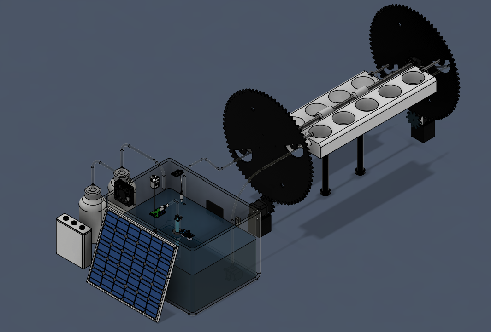

## Why it rotates

In a static vertical rack, plants near the light get far more of it than the plants below. Here two plant racks hang from a pair of large gears and sweep slowly through a 180 degree arc, so every plant spends equal time near the light. The racks pivot freely on their hangers, so gravity keeps them upright at every angle.

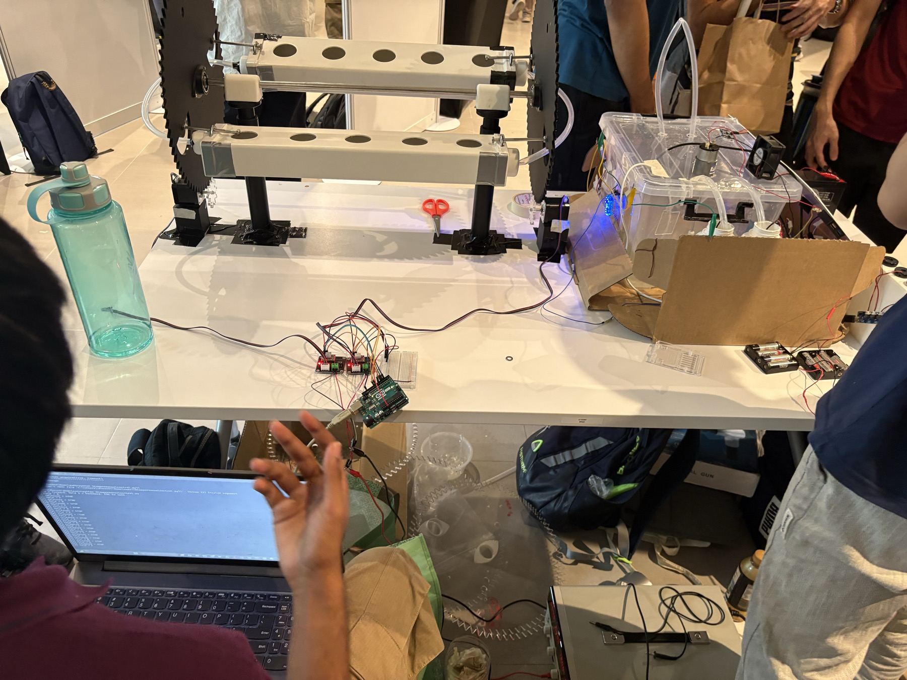

## System overview

Two microcontrollers share the work.

| Board | Job |
|---|---|
| ESP32 (master) | Wi-Fi, Blynk cloud sync, and the control logic for lighting, climate and nutrients |
| Arduino UNO (slave) | Reads the water sensors, switches the pumps and stirrer on command |

The boards talk over UART through a logic-level converter, because the UNO runs at 5 V and the ESP32 at 3.3 V. The UNO sends a sensor packet every 2 seconds, and the ESP32 sends actuator commands back when needed. Both programs use elapsed-time checks instead of `delay()`, so nothing blocks.

A separate Arduino UNO drives the rack rotation.

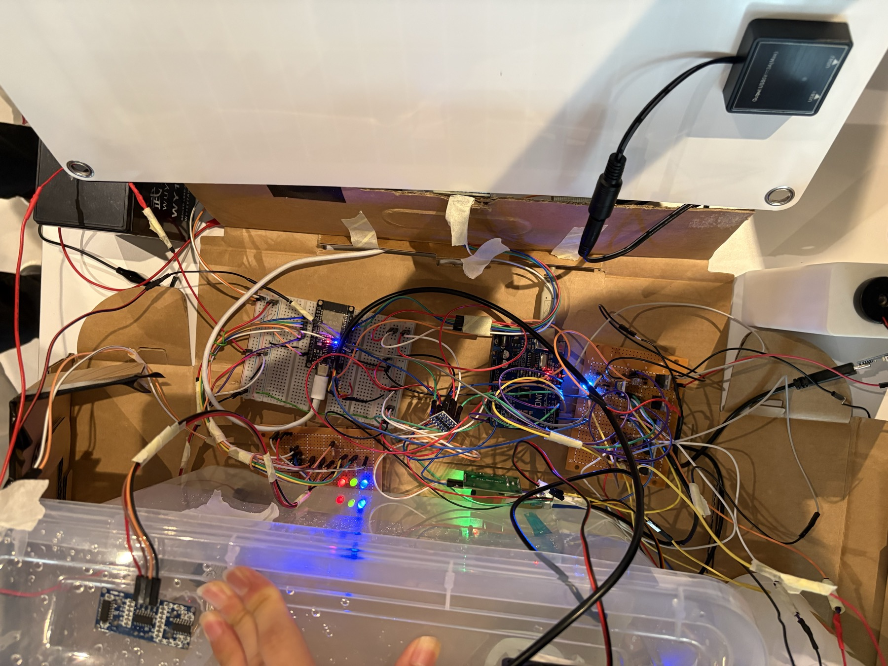

## Subsystems

### Watering and nutrient control

- **Sensors:** TDS meter (EC), pH sensor, DS18B20 water temperature sensor (used to temperature-compensate the EC reading) and an HC-SR04 ultrasonic sensor for the reservoir level.
- **Actuators:** 12 V main water pump on a schedule, a nutrient pump and a pH-down pump that dose when readings drift from the setpoints, and a stirrer that mixes the reservoir after each dose.
- **Switching:** each actuator is switched by a low-side IRLZ44N logic-level MOSFET with a 220 ohm gate resistor, a 10 k pull-down and a flyback diode across the load.

### Lighting

- A photodiode feeds an LM358 transimpedance amplifier, which the ESP32 reads as ambient light.
- Readings are smoothed with an exponential moving average (alpha = 0.2).
- The LED panel (5 branches of 3 LEDs on 12 V) is dimmed by PWM through an IRF530 MOSFET.
- In Auto mode the LEDs make up the difference between the target intensity and the ambient light. The brightness only changes when the result moves by more than 3 percent, which stops flicker.

### Climate

- A DHT22 measures air temperature and humidity.
- A 5 V fan cools the rack and an ultrasonic mist maker raises humidity.
- Both use a hysteresis band (plus or minus 1 degree C, plus or minus 5 percent humidity) so they do not switch rapidly around the setpoint.

### Rotation

- Two NEMA 17 stepper motors on A4988 drivers, stepped in sync with the AccelStepper library.
- A 10-tooth pinion on each motor drives a 75-tooth gear, a 7.5:1 reduction giving about 8.1 N·m combined.
- The worst-case load, from uneven water between the two racks, is about 0.93 N·m, a safety factor of roughly 8.7.
- A full 180 degree sweep takes about 60 seconds, then the motors reverse. Limiting the sweep stops the hoses and wires from tangling.
- A 12 mm stainless steel rod runs through the centre as a fixed axle, so the motor shafts carry no structural load.

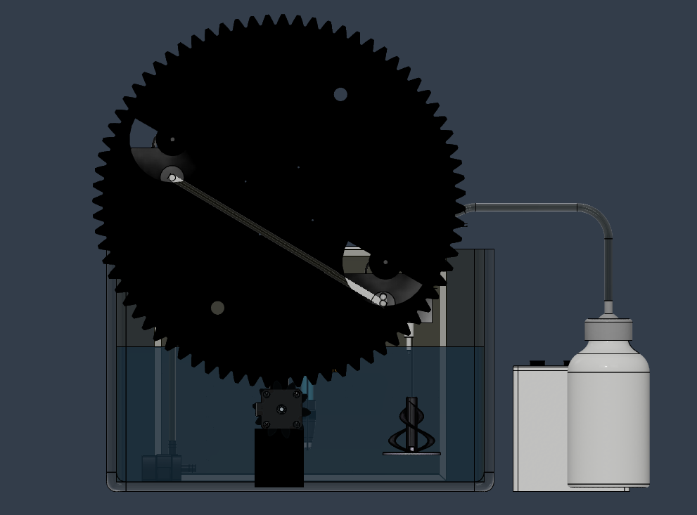

### Water loop

The pump fills the first rack from a base inlet. When the level reaches an overflow hole, water passes to the second rack and drains back to the reservoir. Flexible silicone hose runs through arc-shaped slots cut in the gears, which gives it clearance through the whole sweep.

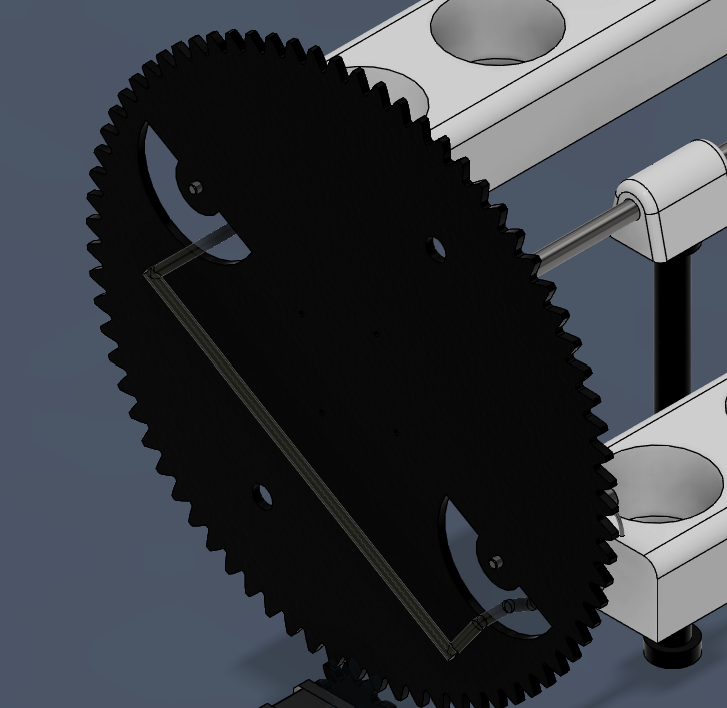

### Dashboard

A Blynk dashboard shows live light, temperature, humidity, EC, pH, water temperature and reservoir level. Every subsystem has an Auto and a Manual mode that can be switched remotely. An OLED on the unit shows the same readings locally.

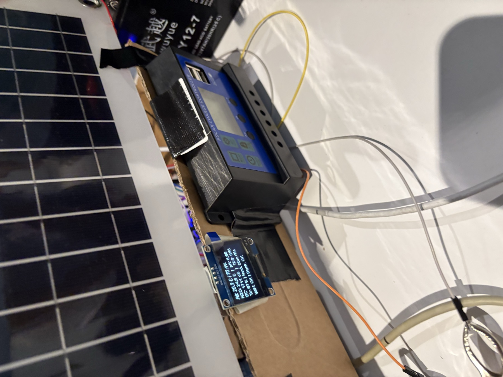

## Repository contents

| Path | Contents |
|---|---|
| `docs/Design-Report.pdf` | Full design report: circuit analysis, mechanical calculations, bill of materials, Blynk screens and the circuit schematic |
| `cad/` | 13 CAD renders: overall views, drive train, axle and bearing, rack pivot and hose routing |
| `photos/` | Photos of the built system |

The firmware is not in this repository yet.

## CAD views

| | |
|---|---|
| 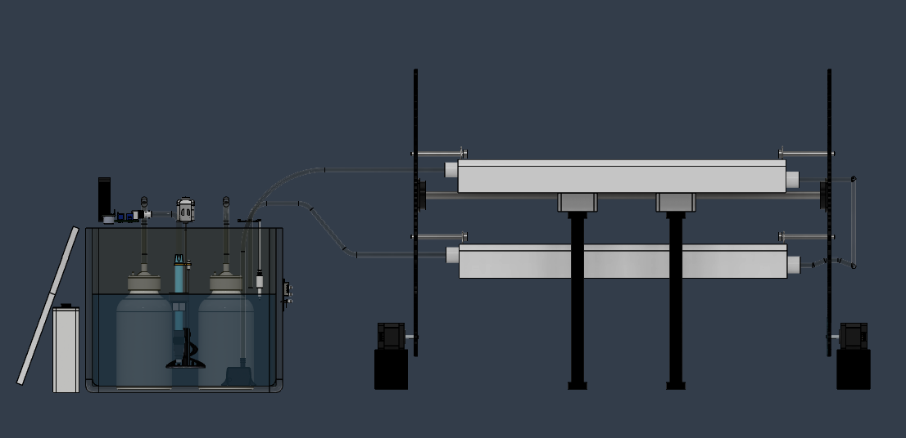 | 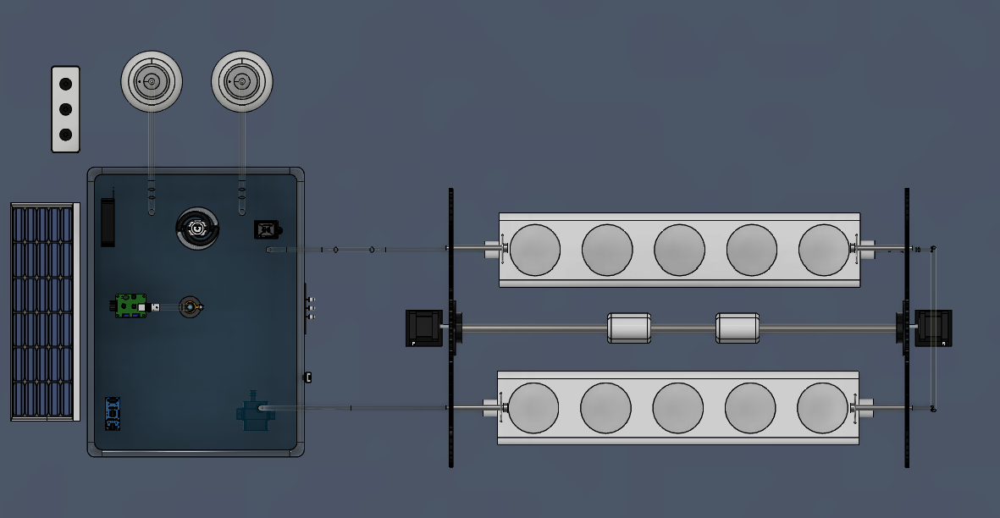 |
| 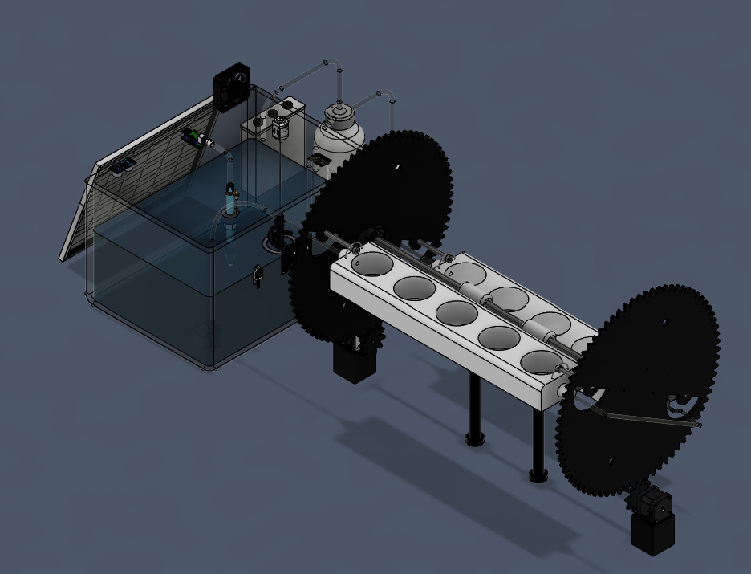 | 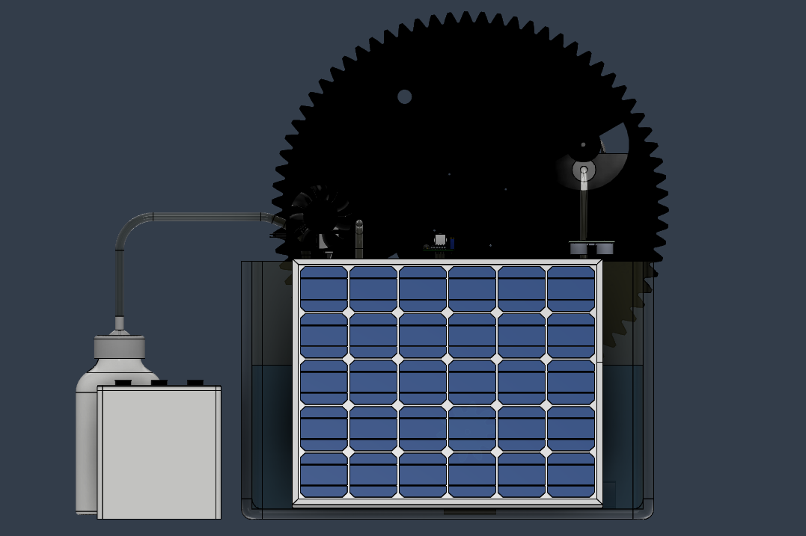 |
| 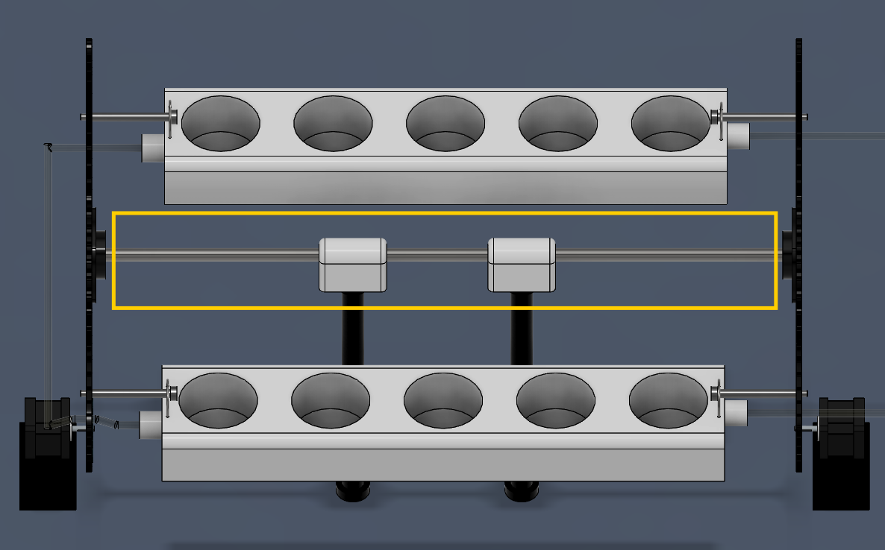 | 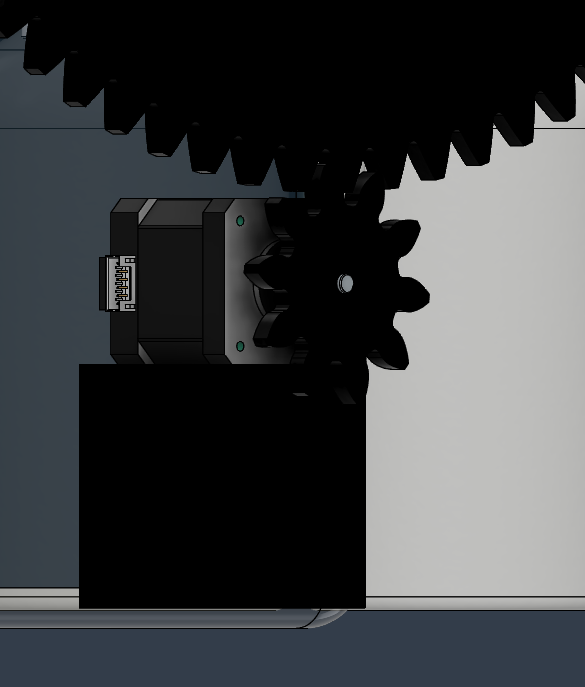 |
| 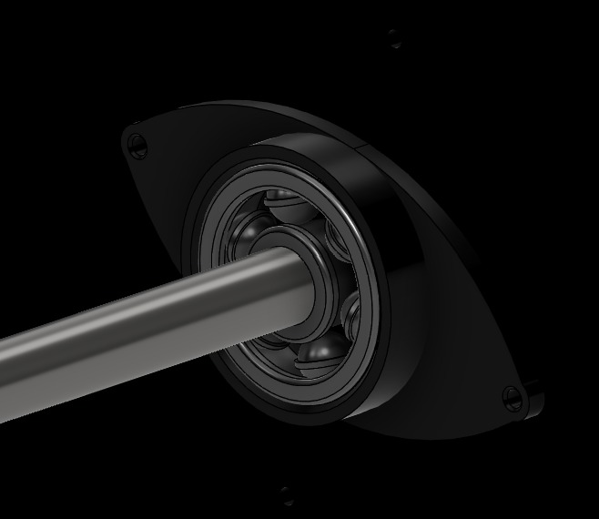 | 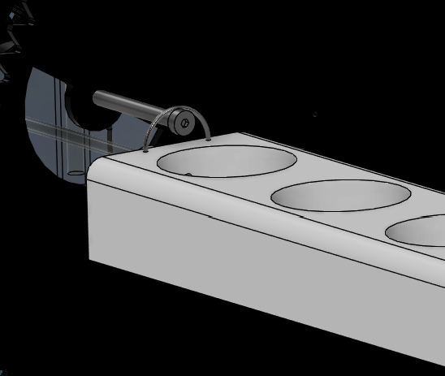 |

## Known limitations

- Low-cost pH and EC sensors drift and pick up electrical noise, so they need periodic calibration.
- As the plants grow, the shifting weight puts more load on the motors and gears.
- Remote control depends on Wi-Fi; a local fail-safe mode is the planned improvement.
